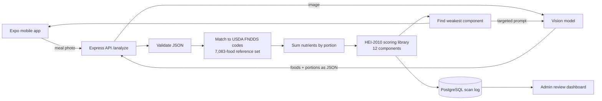

# PatientLens: Architecture & Design

PatientLens turns a photo of a meal into a nutrient breakdown and a 0�100 diet-quality score for colon cancer survivors. The source code is private. This repo explains how the system works and why it's built this way.

## The problem

Survivors are told to improve their diet, but most nutrition apps only count calories. Clinicians measure diet *quality* with the Healthy Eating Index (HEI), a USDA/NCI score built from 12 components. Scoring it by hand from food logs is slow, so patients almost never get feedback.

## System overview

| Layer | Technology |
| --- | --- |
| Mobile | React Native, Expo Router, Clerk auth |
| API | Node.js, Express, structured logging with pino |
| Data | PostgreSQL scan log, USDA FNDDS + FPED reference data |
| Scoring | Standalone TypeScript HEI-2010 library with unit tests |
| Data pipeline | Python ETL that builds the food lookup table from USDA files |
| Admin | React + Vite dashboard |
| Design | Figma prototypes |

## Design decisions

### 1. The model identifies food, and the reference data supplies every number

Vision models are good at naming foods and unreliable with quantities like sodium or fiber. In PatientLens, the model's only job is to return detected foods and portions as structured JSON. Every nutrient value comes from USDA reference data, so results are repeatable and traceable to a source.

### 2. Matching free-text food names to USDA codes

A model might say "grilled salmon" or "chicken biryani". The matcher maps that to one of 7,083 FNDDS foods:

1. **Inverted word index.** Only foods that share a word with the query are scored, instead of all 7,083.
2. **Weighted scoring.** Points for word overlap, a bonus when every query word matches, a bonus when the description's primary identity (the text before the first comma) is the query itself, and penalties for unusual preparations and added toppings. For "salmon", that means "Salmon, baked" beats "Salmon salad".
3. **Fuzzy fallback.** Typos and unmatched words fall back to fuzzy search.

Composite and regional dishes were the hardest. I tuned the weights by checking 50+ real meals against expected matches.

### 3. Density-based scoring and the missing-calorie problem

HEI scores *density*: the amount of each component per 1,000 kcal. That keeps a small healthy meal from being penalized for being small. But it means calories sit in the denominator, and when the calorie estimate is missing, the score can blow up. PatientLens uses an explicit 500 kcal fallback, plus per-100g calorie and sodium fallbacks for incomplete foods. The tradeoff is deliberate: a bounded estimate is better than a confident, wrong score.

### 4. Feedback that a patient can act on

After scoring, the API finds the patient's weakest HEI component and makes a second, narrowly scoped model call for one specific food swap. Patients get one concrete change instead of a list of general advice.

### 5. Failures are distinct and visible

| Status | Meaning |
| --- | --- |
| `400` | Invalid request |
| `422` | Photo contained no food |
| `429` | Upstream model rate limit, retry later |
| `500` | Server error, logged with context |

Each failure can be handled separately in the app and searched in the logs.

## Testing

- Unit tests check the HEI-2010 scoring rules against the official formulas.
- Food matching was checked by hand on 50+ real meals.
- An admin dashboard lets me review every logged scan for accuracy.

## What's next

- Better portion estimation, the largest remaining source of error
- Semantic (embedding-based) matching for regional dishes
- A labeled photo test set so accuracy can be measured automatically
- Research with a MedStar-Georgetown oncology fellow: Institutional Review Board review is underway, and the manuscript is in progress

---

Built by [Tirth Shah](https://github.com/tirthashah2025-tech).
